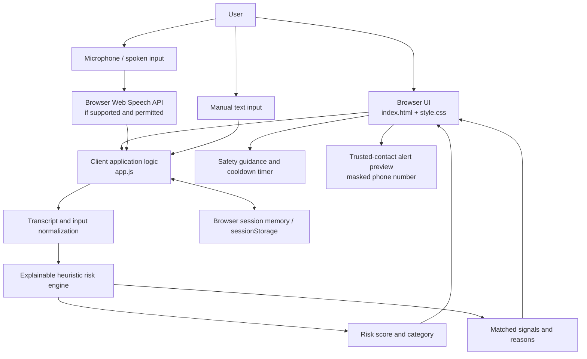
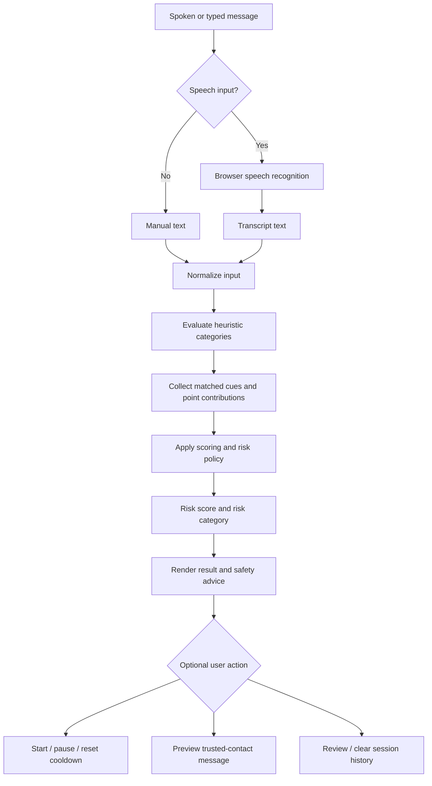

# VoxShield — Technical Design Document (TDD)

**Document status:** Prototype design  
**Project:** VoxShield — Futuristic AI Security Command Center  
**Version:** 1.0  
**Last updated:** 2026-10-26

> This document describes the current browser-based prototype. It does not claim that the prototype performs acoustic voice-clone/deepfake detection or actually blocks financial transactions.

## 1. Purpose

VoxShield is a browser-based safety prototype that helps users pause and assess suspicious conversations. It takes spoken or manually entered text, checks for explainable scam-risk signals, presents a risk level and recommended safety actions, and offers a short cooldown and trusted-contact message preview.

The current prototype focuses on conversational pressure tactics such as digital-arrest threats, authority impersonation, urgent payment demands, OTP/PIN requests, secrecy demands, remote-access app coercion, suspicious accounts, and family-emergency claims.

## 2. Scope and boundaries

### In scope
- Responsive browser interface.
- Speech-to-text through the browser's Web Speech API where supported.
- Manual text entry as a fallback.
- Rule-based, explainable risk scoring.
- Risk category, matched cues, and safety recommendations.
- Five-minute safety cooldown timer.
- Trusted-contact alert preview with phone-number masking.
- Session-only scan history and demo scenarios.

### Out of scope / not implemented
- Acoustic deepfake or voice-clone detection from audio frequencies.
- Automatic call interception or recording.
- Real bank-account, UPI, or payment-app locking.
- Guaranteed fraud detection or a guarantee that a conversation is safe.
- Persistent server-side database or backend API in the current static prototype.

## 3. Users and primary use cases

1. A user speaks or types a suspicious message.
2. The app converts speech to text when browser speech recognition is available.
3. The user selects **Analyze risk**.
4. The risk engine checks text against configured heuristic categories and calculates a score.
5. The UI displays the risk level, matched signals, and recommended safety actions.
6. The user may start a five-minute pause timer and preview a message for a trusted contact.
7. The user can review or clear recent scans stored for the current browser session.

## 4. High-level architecture



**Diagram note:** This is a client-side architecture. The browser's speech-recognition implementation may send speech to the browser provider's service for transcription; the app itself does not save raw audio recordings to disk or upload them to its own backend.

## 5. Component design

| Component | File / technology | Responsibility |
|---|---|---|
| User interface | `index.html` | Page structure, controls, result panels, demo scenarios and user-facing instructions |
| Visual presentation | `style.css` | Responsive layout, dark cybersecurity theme, risk meter, cards and waveform-style visual feedback |
| Application logic | `app.js` | UI event handling, speech-recognition integration, text processing, risk rules, score presentation, cooldown timer, trusted-contact preview and session history |
| Speech recognition | Browser Web Speech API | Converts spoken input into text when supported and permission is granted |
| Risk engine | JavaScript in `app.js` | Evaluates text against configured heuristic fraud signals and produces an explainable risk result |
| Session state | Browser memory / `sessionStorage` | Keeps recent scan history for the current browsing session |
| Automated checks | `test_suite.js`, `test_four_messages.js`, `thorough_verification_pass.js` | Local verification/test scripts; run according to the repository's README instructions |

## 6. Data-flow design



### Input
- Spoken transcript from supported browser speech recognition, or
- Text entered by the user, including a demo scenario.

### Processing
- Normalize the text for rule matching.
- Check configured fraud-risk categories and cues.
- Calculate a score using the application's heuristic policy.
- Retain matched reasons so the result can be explained to the user.

### Output
- Risk score and risk category.
- Matched signals / explanation.
- Recommended safety steps.
- Optional cooldown and trusted-contact message preview.

## 7. Risk assessment design

The prototype uses explainable text heuristics, not a trained acoustic deepfake model. The README describes eight broad categories:

1. Digital-arrest pressure.
2. Authority impersonation.
3. Urgent demands.
4. OTP or credential theft.
5. Secrecy demands.
6. Remote-access app coercion.
7. Suspicious accounts or payment instructions.
8. Family-emergency claims.

The implementation should expose the matched cues and their score contributions so users can understand why a result was produced. A single isolated keyword should not automatically be treated as conclusive proof of fraud. The final score and thresholds are implementation details and should be kept consistent with `app.js`; update this section if those rules change.

**Interpretation warning:** A risk score is a warning signal, not proof that a person is fraudulent or trustworthy. Users should independently verify claims through a known, trusted channel.

## 8. User interface and interaction states

Typical speech-input states:
- Ready
- Requesting microphone permission
- Listening
- Speech detected
- Transcript received
- Stopped or unavailable / error

Typical analysis states:
- No result yet
- Analysis complete with lower-risk, caution, or high-risk classification
- Demo scenario loaded
- Session history populated or cleared

The interface should provide understandable status text and avoid relying on color alone to communicate risk.

## 9. Privacy and security design

- The prototype does not require permanent storage of raw microphone recordings.
- Risk matching and scoring run in browser-side JavaScript.
- Phone numbers shown in trusted-contact previews are masked.
- Session history is temporary and can be cleared by the user.
- No server-side account system, backend API, or database is part of the current static prototype.
- Browser speech-to-text is provided by the browser platform. Depending on the browser, speech recognition may communicate with the provider's servers. Users should be told this clearly.
- Do not enter real OTPs, PINs, passwords, banking credentials, or other secrets into the prototype.
- Do not treat the cooldown timer as an actual payment lock or financial security control.

## 10. Error handling and fallback behavior

- If speech recognition is unsupported or permission is denied, allow manual text entry.
- If no transcript or text is supplied, ask the user to enter a message before analysis.
- If a browser API is unavailable, keep unrelated interface features usable where possible.
- If a demo scenario is used, make it clear that it is sample content.
- If a result is ambiguous, advise independent verification rather than presenting the result as certainty.

## 11. Non-functional requirements

- **Usability:** Main workflow should be understandable without technical training.
- **Responsiveness:** Layout should adapt to desktop and smaller screens.
- **Explainability:** Display the signals behind a risk result.
- **Privacy:** Avoid saving raw audio and provide a clear way to clear session history.
- **Reliability:** Handle unsupported browser features and missing input gracefully.
- **Maintainability:** Keep interface, styling and application logic separated across HTML, CSS and JavaScript files.
- **Accessibility:** Use readable contrast, visible focus states, labels for controls, and text equivalents for visual risk indicators.

## 12. Technology stack

- HTML5 for page structure.
- CSS3 for styling and responsive layout.
- Vanilla JavaScript (ES6+) for client-side behavior.
- Browser Web Speech API for speech-to-text where supported.
- Browser memory / `sessionStorage` for session state.
- Node.js-based scripts for local test verification.

No backend service or paid external API is required for the core prototype.

## 13. Testing and verification plan

| Test area | Example verification |
|---|---|
| Manual input | Enter a normal message and confirm that analysis runs |
| High-risk demo | Load the digital-arrest demo and inspect the risk result and matched signals |
| OTP/PIN scenario | Load the bank/OTP demo and confirm safety guidance appears |
| Remote-access scenario | Load the remote-access app demo and confirm relevant cues are explained |
| Benign scenario | Load the clinic reminder demo and verify it is not automatically treated as high risk |
| Speech recognition | Test in a supported browser after granting microphone permission |
| Permission denial | Deny microphone access and confirm manual input remains available |
| Cooldown timer | Start, pause, resume and reset the timer |
| Trusted contact | Preview an alert and confirm the displayed phone number is masked |
| Session history | Add scans, revisit a prior scan if supported, then clear history |
| Responsive layout | Check the interface at desktop and narrow viewport sizes |
| Regression checks | Run the repository's test scripts and record pass/fail output |

Do not claim a test passed unless it has actually been run. Record browser/version and test date for formal evaluation.

## 14. Deployment design

The current prototype is a static browser application. It can be opened locally or served as static files. No build step or backend deployment is required for the core UI. Speech-recognition behavior depends on browser support, permissions and browser-provider implementation.

For a future production version, consider HTTPS hosting, explicit privacy notices, stronger accessibility testing, formal evaluation of the scoring rules, and a documented review process for false positives and false negatives.

## 15. Limitations and future improvements

### Current limitations
- The prototype identifies suspicious language patterns; it does not analyze acoustic fingerprints to detect cloned voices.
- Speech recognition may depend on external browser-provider services.
- Heuristic rules may miss new scam wording or flag legitimate messages.
- The cooldown timer is educational and does not block payments.
- Session history is not a permanent audit database.

### Possible future improvements
- Add a separately validated acoustic deepfake-detection model only after selecting lawful datasets and measuring performance.
- Evaluate false-positive and false-negative rates across languages, accents and noisy environments.
- Add configurable rules with versioning and regression tests.
- Improve keyboard navigation, screen-reader support and clear error messages.
- Add a privacy-preserving, consent-based audit trail only if a real backend is introduced.

## 16. Repository mapping

```text
VoxShield/
├── README.md
├── README.txt
├── app.js
├── index.html
├── style.css
├── test_four_messages.js
├── test_suite.js
├── thorough_verification_pass.js
└── docs/
    └── Technical_Design_Document.md
```

The `docs/` directory and TDD file are proposed additions. Keep the diagram sources in Mermaid format inside this Markdown file so GitHub can render them directly. Separate PNG/SVG exports can be added later if the submission rules require image files.

## 17. Change log

| Version | Date | Change |
|---|---|---|
| 1.0 | 2026-10-26 | Initial TDD for the current browser-based VoxShield prototype |
